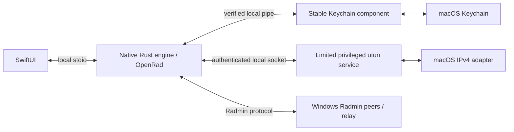

# Radmin VPN Mac

**A native macOS client for existing Radmin VPN networks.**

SwiftUI interface, native Rust networking, and a macOS virtual adapter. No Wine,
CrossOver, Rosetta, Windows services, or proprietary DLLs are required.

[Русский](README.ru.md) · [Downloads](https://github.com/islamyus/radmin-vpn-mac/releases) · [Build guide](docs/building.md) · [Troubleshooting](docs/troubleshooting.md)

> Independent community project. Not affiliated with or endorsed by Famatech.
> Apple Silicon is the tested platform. Builds are locally signed, **not Apple
> Developer ID signed or notarized**.

## Features

- Join existing private Radmin VPN networks and reconnect with the same device identity.
- Native SwiftUI window with network groups, per-network selection, light/dark themes,
  peer status, and authenticated latency measurements.
- Direct TCP, direct UDP, and relay transports through the [OpenRad](https://github.com/gringoestrangeiro/openrad) engine.
- IPv4 traffic through a macOS `utun` adapter, with Ethernet/ARP translation and MTU 1500.
- Device credentials in macOS Keychain; network passwords are not saved by the application.
- A limited privileged adapter service installed once, rather than a new sudo request
  for every connection.
- Optional Mac/Windows throughput and integrity tests with SHA-256 verification.

## Install and connect

1. Download a DMG from [Releases](https://github.com/islamyus/radmin-vpn-mac/releases),
   open it, and copy **Radmin VPN.app** to **Applications**.
2. Launch the app and press the power button. Approve the initial adapter-service
   installation in the macOS system dialog. Keychain may separately request access
   to the saved device, particularly when upgrading an older development build.
3. Choose **Сеть → Присоединиться к сети…** and enter the same network name and
   password used by the Windows participants.
4. Wait for the peer to connect. Its `26.x.x.x` address can then be used by games
   and other IPv4 applications.

The current interface is in Russian. Repeated joins do not require the network
password once server membership has been saved. Administrator authorization and
Keychain authorization are separate macOS permissions.

### Minecraft Java

On the hosting computer, open the world to LAN and note the port shown in chat.
On the other computer, use **Multiplayer → Direct Connection** and enter
`<host Radmin IP>:<LAN port>`. Both players need compatible game versions/mods.
Automatic LAN-world discovery across the virtual adapter is not guaranteed;
connect directly by IP and port.

## Build from source

Requirements: macOS 14+, Swift 6/Xcode, Rust 1.95+, Python 3, and the standard
macOS command-line tools. Install Rust through [rustup](https://rustup.rs/).

```sh
git clone https://github.com/islamyus/radmin-vpn-mac.git
cd radmin-vpn-mac
zsh scripts/build-dmg.sh
```

The DMG and self-contained `.app` are written to `dist/`. Rust and Python are
build tools; end users do not need them to run the application. Source builds
create a private local signing identity under the ignored `build/` directory;
those keys are never part of the app or the public repository.

```sh
swift test
cargo test --manifest-path native/Cargo.toml --locked
cargo test --manifest-path vendor/openrad/Cargo.toml --lib --locked
```

See [building and signing](docs/building.md) for additional checks and packaging.
Intel source builds are not covered by the real interoperability checks.

## Architecture



The application and protocol engine run as the current user. The privileged
service handles only the adapter and its restricted routes; it does not handle
Radmin authentication or credentials. Fresh installations store non-secret
runtime data in `~/Library/Application Support/Radmin VPN/`. Existing development
profiles retain their original location and Keychain account.

## What has been tested

Real interoperability checks with official Windows Radmin VPN clients covered
registration, private-network membership, direct TCP/UDP, relay, IPv4 ping,
MTU 1500, bidirectional transfers with SHA-256 checks, and a Minecraft Java
connection. The user also confirmed successful use with a phone hotspot and a
separate VPN. These are specific tested setups, not a guarantee for every NAT,
firewall, or external VPN.

The implementation currently carries **IPv4**, not arbitrary Ethernet or IPv6.
Some settings and remote-management actions from the Windows application are
not implemented. Changing the small Keychain component itself can require a
new authorization; routine UI/engine rebuilds reuse the same component.
See [architecture and limitations](docs/architecture.md).

## Contributing

Bug reports, macOS testing, and focused pull requests are welcome. Include macOS
version, CPU architecture, app version, transport type, and the exact error.
Redact network names, device addresses, and personal information. Never attach
Keychain exports, identities, private keys, or unredacted packet captures.

Read [CONTRIBUTING.md](CONTRIBUTING.md) and [SECURITY.md](SECURITY.md).

## License and credits

Project code is **GPL-3.0-only**; see [LICENSE](LICENSE) and [NOTICE](NOTICE).
The vendored OpenRad snapshot retains its MIT license and author notices;
macOS-specific GPL additions are identified in [vendor/openrad/LOCAL_CHANGES.md](vendor/openrad/LOCAL_CHANGES.md).

- [OpenRad](https://github.com/gringoestrangeiro/openrad) by estrangeiro,
  asimplestray, and contributors provides the native protocol engine.
- [radmin-vpn-linux](https://github.com/baptisterajaut/radmin-vpn-linux) by
  baptisterajaut and contributors informed the adapter research.
- Radmin VPN is a product and trademark of Famatech. No proprietary Radmin
  installer, DLL, service, or driver is included.
